# SmartFridge AI IoT 🧊🤖

### AI-Powered Refrigerator Monitoring, Food Inventory & Location-Aware Grocery Recommendations

SmartFridge AI IoT is a working IoT prototype that combines embedded sensing, cloud messaging, AI-powered image analysis and a web dashboard to help users monitor refrigerator conditions, understand what food they have, plan meals and make more informed grocery purchases.

The system uses two edge devices: a **Raspberry Pi 2 Model B** for temperature/humidity sensing, door-state detection and camera capture, and a **Maker Feather AIoT S3** for freezer water-level monitoring. Both devices publish telemetry to an MQTT broker hosted on a Google Cloud Platform virtual machine. A FastAPI backend processes the messages, stores meaningful events and inventory results in Supabase, and updates a React dashboard through REST APIs and WebSockets.

A key feature is the **location-aware grocery store finder**, which combines the user's location with Malaysia's PriceCatcher data to compare nearby stores and available item prices.

---

## 🎬 Project Demonstrations

The project has two separate demonstrations: one showing the physical IoT prototype and another focusing on the application interface and its features.

<h3>🎬 Project Demonstrations</h3>

<table>
  <tr>
    <th width="35%">Application-Only Demonstration</th>
    <th width="65%">Physical Demonstration</th>
  </tr>
  <tr>
    <td width="35%" align="center" valign="middle">
      <a href="https://youtu.be/4PdawfRptzo">
        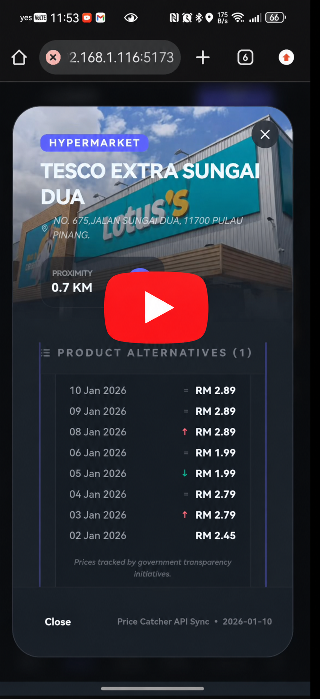
      </a>
    </td>
    <td width="65%" align="center" valign="middle">
      <a href="https://youtu.be/7mcuQvQeb7c">
        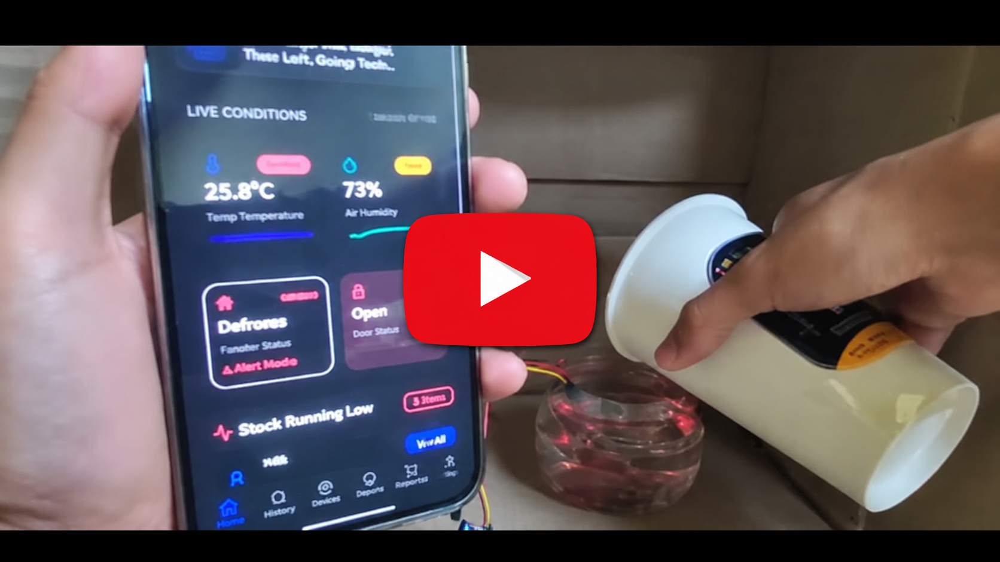
      </a>
    </td>
  </tr>
</table>


---

## ✨ Key Features

### 1. Real-Time Refrigerator Monitoring

- Monitor refrigerator temperature and humidity through a DHT11 sensor.
- Detect refrigerator door state using an infrared obstacle detector.
- Monitor freezer water presence as an indicator of possible defrosting or melting.
- Display live temperature, humidity, door and freezer status on the dashboard.
- Push sensor updates to the frontend in real time without requiring a page refresh.

### 2. Event-Based Alerts & Anomaly History

The backend tracks meaningful events instead of storing every sensor reading as a permanent record.

- Tracks how long the refrigerator door remains open.
- Sends recurring reminders if the door remains open beyond the configured five-minute threshold.
- Tracks freezer water-detection events and raises alerts when defrosting is indicated.
- Stores resolved anomaly summaries in Supabase, including the start time, end time and event duration.
- Provides notification and alert-history views so users can review low-stock warnings and previous incidents.

### 3. AI-Powered Food Inventory

- Captures a refrigerator image after the door closes.
- Briefly activates an LED during the capture sequence to improve image visibility.
- Uploads the snapshot to Supabase Storage and publishes its image URL through MQTT.
- Uses Google Gemini Flash to analyse the image and extract structured food-item information.
- Saves the extracted inventory results in Supabase and updates the dashboard.
- Displays the latest refrigerator snapshot alongside the recognised stock list.

### 4. Gemini Chef AI — Recipe Suggestions

- Generates recipe suggestions from user input and available ingredients.
- Provides recipe details and step-by-step cooking instructions.
- Helps users make better use of ingredients already in the refrigerator.

### 5. Location-Aware Grocery Store Finder

The store finder connects inventory needs with real grocery price information.

- Uses Malaysia's official PriceCatcher datasets published through OpenDOSM, alongside the Hargapedia grocery-price integration identified in the project description.
- Combines premise, item and monthly price records to identify relevant store options.
- Filters and ranks nearby premises using the user's location and geographical distance calculations (including Haversine-based distance comparison).
- Compares available prices for searched items across nearby stores.
- Helps users identify convenient stores and lower-priced purchasing options.
- Connects low-stock items with grocery searches and replenishment decisions.

### 6. Email Alerts & Cross-Device Notifications

Users can bind an email address to their profile and configure email alert preferences. When the system detects relevant refrigerator conditions, it can send notifications to that address as an additional channel alongside the web dashboard.

- Associate a user email address with the SmartFridge profile.
- Receive email alerts for detected conditions, including door-state, temperature and humidity alerts.
- Access notifications through an email client on a laptop or another device, even when the SmartFridge dashboard is not open or actively being monitored.
- Complement in-app notifications with an external notification channel, reducing reliance on keeping the website visible.

An example of the delivered door, temperature and humidity alert emails is included in the Application Screenshots section.

### 7. Shopping List & In-App Notifications

- Add items from low-stock inventory or through manual entry.
- Mark items as purchased.
- Display low-stock warnings and refrigerator anomaly reminders within the web application.
- Manage notification preferences and the email address used for alert delivery through user profile settings.

---

## 🏗️ System Architecture

The architecture diagram below shows the complete data flow from the sensors and edge devices to the cloud MQTT broker, backend, Supabase storage and web dashboard.

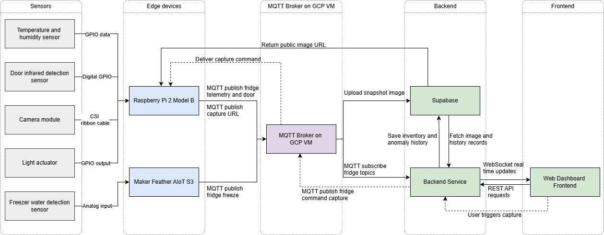

### Main Components

| Layer | Component | Responsibility |
|---|---|---|
| Sensors | DHT11, infrared detector, camera, water-level sensor, LED | Capture refrigerator and freezer conditions and support image capture |
| Edge devices | Raspberry Pi 2 Model B | Reads temperature/humidity and door state; controls camera capture and lighting |
| Edge devices | Maker Feather AIoT S3 | Reads the freezer water-level sensor and publishes freezer status |
| Messaging | MQTT broker on a GCP VM | Routes telemetry, capture URLs and capture commands between devices and backend |
| Backend | FastAPI | Subscribes to MQTT topics, processes events, handles image analysis, serves application APIs and triggers configured email alerts |
| Storage | Supabase | Stores snapshots, inventory results and resolved anomaly records |
| Frontend | React / TypeScript | Displays live conditions, inventory, alerts, recipes, grocery recommendations and user notification settings |
| Email notifications | User-bound email address | Delivers alert messages outside the active web dashboard |

### Data Flow

1. The Raspberry Pi and Maker Feather collect readings from their connected sensors.
2. Both edge devices publish telemetry and status messages to the MQTT broker hosted on a Google Cloud Platform virtual machine.
3. The FastAPI backend subscribes to the relevant MQTT topics and processes incoming messages.
4. The backend keeps the latest sensor values available for live display and selectively persists meaningful records in Supabase.
5. The React dashboard retrieves application data through REST APIs and receives live changes through WebSockets.
6. For inventory capture, the Raspberry Pi uploads a snapshot to Supabase Storage and publishes the resulting image URL through MQTT. The backend retrieves the image, sends it to Gemini Flash and stores the extracted inventory results.
7. When email alerts are enabled, the backend sends relevant condition notifications to the email address associated with the user's profile. This provides an additional way to receive alerts when the dashboard is not being watched.

---

## 🖥️ Application Screenshots

The following screenshots are taken from the project demonstration, technical report and email-alert test. The personal profile screen is omitted from the public gallery because it contains account-specific information. The application-only video preview is available in the Demonstrations section above.


<table>
  <tr>
    <td width="33%" align="center" valign="top">
      <strong>Live Dashboard</strong><br><br>
      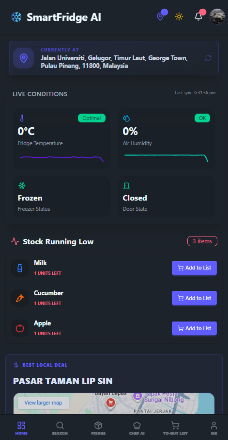<br>
      Live temperature, humidity, door and freezer status, with low-stock items.
    </td>
    <td width="33%" align="center" valign="top">
      <strong>Info & Notifications</strong><br><br>
      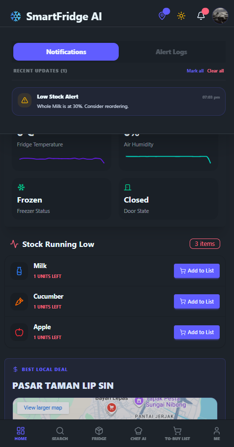<br>
      Low-stock warnings and anomaly reminders.
    </td>
    <td width="33%" align="center" valign="top">
      <strong>Alert History</strong><br><br>
      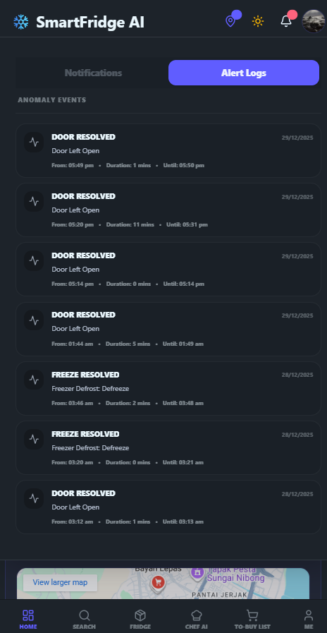<br>
      Stored summaries of resolved refrigerator and freezer events.
    </td>
  </tr>
  <tr>
    <td width="33%" align="center" valign="top">
      <strong>Food Inventory</strong><br><br>
      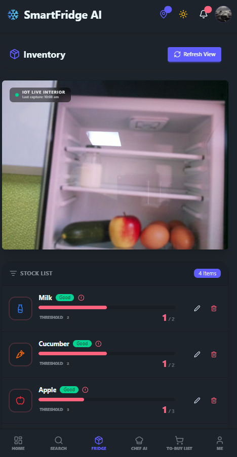<br>
      Latest refrigerator snapshot and AI-extracted stock list.
    </td>
    <td width="33%" align="center" valign="top">
      <strong>Grocery Store Finder</strong><br><br>
      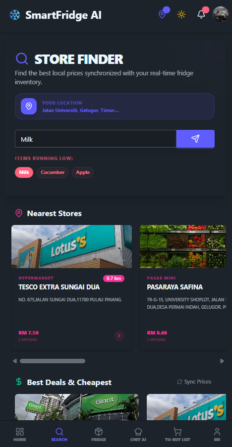<br>
      Nearby stores and comparable grocery prices.
    </td>
    <td width="33%" align="center" valign="top">
      <strong>Chef AI</strong><br><br>
      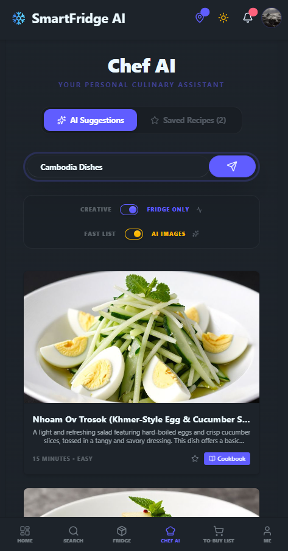<br>
      Recipe suggestions based on available ingredients and user input.
    </td>
  </tr>
  <tr>
    <td width="33%" align="center" valign="top">
      <strong>To-Buy List</strong><br><br>
      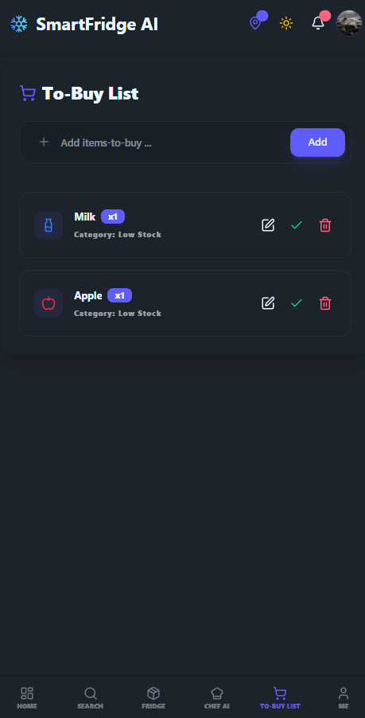<br>
      Shopping reminders from low-stock items or manual entries.
    </td>
    <td width="33%" align="center" valign="top">
      <strong>Email Notification Settings</strong><br><br>
      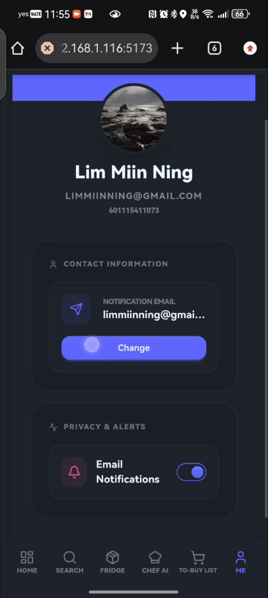<br>
      Email address binding & Notification Enablement
    </td>
    </td>
    <td width="33%" align="center" valign="top">
      <strong>Email Alerts</strong><br><br>
      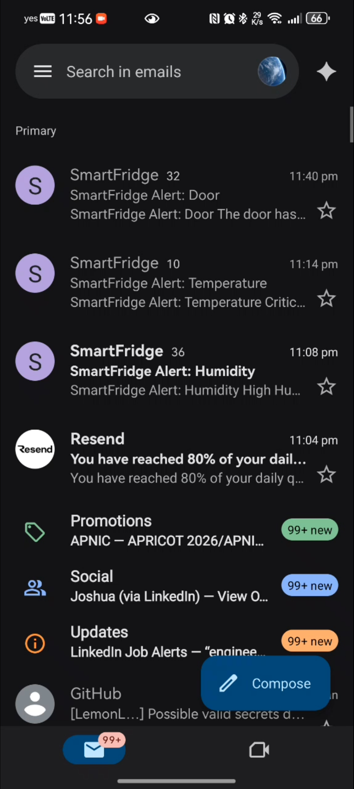<br>
       Alert emails delivered to the user's bound email address.
    </td>
  </tr>
</table>


---

## 🔌 Hardware & Wiring

The prototype separates sensing responsibilities across two edge devices to keep the wiring and device roles manageable.

### Raspberry Pi 2 Model B — Refrigerator Monitoring

The Raspberry Pi is positioned near the refrigerator door and handles:

- DHT11 temperature and humidity readings.
- Infrared door-state detection.
- Raspberry Pi Camera Module Rev 1.3 (OV5647) snapshot capture through the CSI connector.
- GPIO-controlled LED illumination during the snapshot sequence.
- MQTT publishing for telemetry, door events and snapshot URLs.

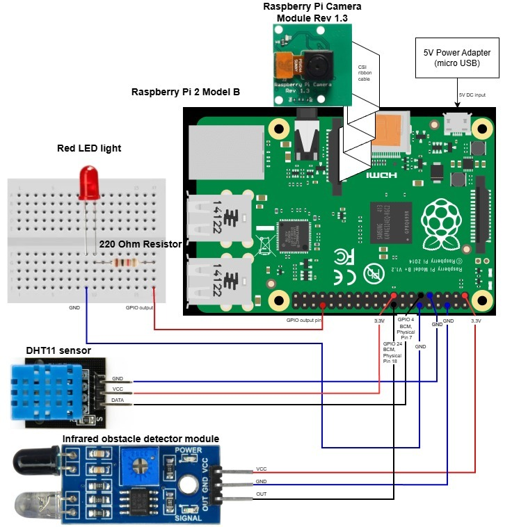

### Maker Feather AIoT S3 — Freezer Monitoring

The Maker Feather AIoT S3 is positioned near the freezer and reads the water-level sensor through analog input A3. The firmware converts the analog reading into a freezer status message and publishes it through MQTT.

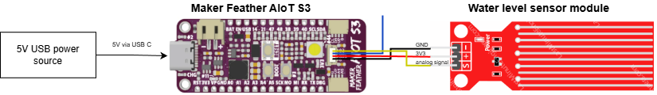

### Hardware List

| Component | Role |
|---|---|
| Raspberry Pi 2 Model B | Main edge node for refrigerator monitoring and camera capture |
| Maker Feather AIoT S3 | Secondary edge node for freezer monitoring |
| DHT11 | Temperature and humidity sensing |
| Infrared obstacle detector | Refrigerator door-state detection |
| Raspberry Pi Camera Module Rev 1.3 (OV5647) | Refrigerator snapshot capture |
| Water-level sensor module | Detects water presence associated with possible freezer defrosting or melting |
| Red LED and 220 Ω resistor | Brief illumination during snapshot capture |

---

## ⚙️ Implementation Details

### Sensor Sampling & Event Logic

The following values describe the configuration documented for the prototype:

| Function | Implementation |
|---|---|
| DHT11 sampling | Raspberry Pi reads the sensor every 4 seconds by default |
| Temperature publishing | Publishes when temperature changes by at least 0.2 °C or 30 seconds have elapsed since the previous publication |
| Door input | Infrared detector connected to Raspberry Pi GPIO 24 using BCM numbering; LOW represents closed and HIGH represents open |
| Door reminder | If the door remains open beyond 5 minutes, reminders repeat every 5 minutes until it closes |
| Door event history | On resolution, stores event start time, end time and duration |
| Freezer sensor | Maker Feather reads the water sensor through analog pin A3 and publishes status every 10 seconds |
| Freezer threshold | ADC values above 2000 are treated as `Defreeze`; values at or below 2000 are treated as `Frozen` |

### Snapshot-to-Inventory Workflow

1. The Raspberry Pi detects the refrigerator door closing.
2. A short countdown begins and the LED briefly illuminates the refrigerator interior.
3. The camera captures a snapshot.
4. The Raspberry Pi uploads the image to Supabase Storage and receives a public image URL.
5. The image URL is published through MQTT.
6. The FastAPI backend retrieves the image and sends it to Google Gemini Flash with a structured prompt.
7. Gemini returns extracted food-item information.
8. The backend saves the inventory result in Supabase and updates the dashboard.

### Selective Data Persistence

The backend keeps the latest sensor readings in memory for live dashboard updates rather than permanently storing every telemetry message. Supabase is used for meaningful records, including resolved anomaly summaries and AI-generated inventory results. Refrigerator snapshots are stored in Supabase Storage.

### Grocery Price & Location Data

The store recommendation service uses three PriceCatcher datasets published through OpenDOSM:

- `lookup_premise` — premise codes, store names, addresses and premise information.
- `lookup_item` — item codes, names, units and categories.
- `monthly_pricecatcher` — dated price records linking premises and items.

The backend joins these datasets, translates codes into readable store and item information, filters results using the user's location and ranks nearby premises with comparable prices.

---

## 🛠️ Technology Stack

### Frontend

- **React** and **Vite** — frontend application.
- **TypeScript** — application logic and type definitions.
- **Tailwind CSS** and **DaisyUI** — styling and interface components.
- **Lucide React** — icons.
- **Recharts** — dashboard visualisation.

### Backend & AI

- **Python** and **FastAPI** — backend services and REST APIs.
- **Uvicorn** — ASGI server.
- **Google Gemini Flash** — image-based food recognition and inventory extraction.
- **Pandas** — grocery price data processing.
- **Geopy**, **Geoapify API** and optional Windows geolocation integration (`winsdk`) — location and geocoding support.
- **WebSockets** — live dashboard updates.

### Embedded Systems & IoT

- **Raspberry Pi 2 Model B** — Linux-based edge device, sensor polling and camera capture.
- **Maker Feather AIoT S3 (ESP32-S3)** — analog water-level sensing and freezer status publishing.
- **Arduino-style C++ firmware** — Maker Feather sensor acquisition and MQTT publishing.
- **Python** — Raspberry Pi sensor and camera integration.
- **MQTT** — edge-to-cloud messaging.

### Cloud, Storage & Data

- **Google Cloud Platform VM** — MQTT broker hosting.
- **Supabase** — snapshot storage, inventory results and anomaly history.
- **Malaysia PriceCatcher / OpenDOSM** — grocery premise, item and price data.
- **Docker** — containerisation of the Raspberry Pi edge software to keep its camera and sensor-publishing dependencies consistent.

> **Deployment note:** In the documented final setup, Docker is used for the Raspberry Pi edge node. The FastAPI backend runs directly using the standard Python/Uvicorn setup; the backend is not described as a Docker container in the project report.

---

## 🚀 Setup & Installation

### Prerequisites

- Python and pip
- Node.js and npm
- Git
- Raspberry Pi OS / Linux environment for the Raspberry Pi edge node
- Arduino-compatible development environment for Maker Feather AIoT S3 firmware
- Google Gemini API key
- Supabase project and storage configuration
- MQTT broker access
- Geoapify API key if using the configured geocoding integration

### 1. Backend Setup

```bash
cd backend
python -m venv .venv
```

Activate the virtual environment.

**Windows**

```powershell
.venv\Scripts\activate
```

**Linux / macOS**

```bash
source .venv/bin/activate
```

Install dependencies:

```bash
pip install -r requirements.txt
```

Create a `.env` file in the backend directory. The following illustrates the configuration categories; use the exact variable names expected by the current source code.

```env
GEMINI_API_KEY=your_google_ai_api_key
GEOAPIFY_API_KEY=your_geoapify_api_key
SUPABASE_URL=your_supabase_project_url
SUPABASE_KEY=your_supabase_key
MQTT_BROKER_HOST=your_gcp_vm_address
MQTT_BROKER_PORT=1883
MQTT_USERNAME=your_mqtt_username
MQTT_PASSWORD=your_mqtt_password
```

Start the FastAPI backend:

```bash
uvicorn server:app --host 0.0.0.0 --port 8000 --reload
```

The backend is then available at `http://localhost:8000`.

### 2. Frontend Setup

```bash
cd frontend
npm install
```

Create a `.env` file in the frontend directory:

```env
VITE_API_BASE_URL=http://localhost:8000
```

For access from another device, replace `localhost` with the backend machine's reachable IP address.

Start the development server:

```bash
npm run dev
```

### 3. Raspberry Pi Edge Node

- Connect the DHT11, infrared detector, camera module and LED according to the wiring diagram above.
- Configure the Raspberry Pi's network access and MQTT broker connection.
- Set the broker host, port and authentication details to match the GCP-hosted MQTT broker.
- Build and run the Raspberry Pi edge software using the Docker configuration provided in the repository. Docker is used here to keep the camera and sensor-publishing dependencies consistent.
- Verify that sensor telemetry, door-state changes and snapshot URLs are published to the expected MQTT topics.

### 4. Maker Feather AIoT S3

- Connect the water-level sensor to the Maker Feather AIoT S3 analog input A3, observing the board's supported input-voltage limit.
- Configure Wi-Fi and MQTT broker connection details in the firmware.
- Flash the Arduino-style C++ firmware to the board.
- Verify that freezer status messages are published periodically and received by the backend.

### 5. Cloud & Storage Configuration

- Host the MQTT broker on a Google Cloud Platform VM and configure the broker address, port and authentication consistently across the edge devices and backend.
- Configure Supabase Storage for refrigerator snapshots.
- Configure Supabase database access for inventory results and anomaly summaries.
- Ensure the backend can retrieve uploaded snapshot URLs and communicate with the Gemini API.

---

## 🌱 Sustainability & SDG 11

SmartFridge AI IoT supports **United Nations Sustainable Development Goal 11: Sustainable Cities and Communities** by addressing everyday sources of household food waste.

- **Earlier warnings:** Temperature, door-state and freezer monitoring help users identify risky conditions before food spoilage occurs.
- **Better inventory awareness:** AI-assisted snapshots help users see what is already in the refrigerator and reduce forgotten or duplicate purchases.
- **Smarter grocery decisions:** Nearby store and price comparisons help users make more informed purchasing choices.
- **More efficient routines:** Notifications, anomaly history and shopping lists support better household planning.

The prototype demonstrates how connected sensing, event-based alerts and inventory intelligence can encourage more sustainable everyday habits. Long-term impact would depend on reliable operation and consistent use in a real household environment.

---

## 📁 Repository Structure

```text
SmartFridge_AI_IOT/
├── backend/                 # FastAPI services, AI integration, MQTT and recommendation logic
├── frontend/                # React and TypeScript web dashboard
├── docs/
│   ├── images/              # Architecture, wiring diagrams and application screenshots
│   └── videos/
│       └── app-only-demo.mp4
└── README.md
```

The tree above shows the main project areas and the documentation assets added for this README. Refer to the repository for the current edge-device source and firmware file locations.

---

## 🔐 Configuration & Security Notes

- Do not commit `.env` files, API keys, MQTT passwords or Supabase credentials.
- Keep Gemini credentials on the backend; do not expose them in frontend environment variables.
- Restrict MQTT broker access and use authentication.
- Protect email-delivery credentials and keep them out of source control.
- Apply appropriate access controls to Supabase Storage and database resources.
- Review third-party API usage limits and the terms governing external datasets.

---

## 📚 Data Sources & References

- [OpenDOSM — PriceCatcher Premise Lookup](https://open.dosm.gov.my/data-catalogue/lookup_premise)
- [OpenDOSM — PriceCatcher Item Lookup](https://open.dosm.gov.my/data-catalogue/lookup_item)
- [Malaysia PriceCatcher monthly transaction data](https://storage.data.gov.my/pricecatcher/pricecatcher_2025-12.csv)
- [Google Gemini API](https://ai.google.dev/)
- [Supabase](https://supabase.com/)
- [Geoapify](https://www.geoapify.com/)
- [Raspberry Pi](https://www.raspberrypi.com/)
- [Maker Feather AIoT S3](https://circuitpython.org/board/cytron_maker_feather_aiot_s3/)

Data obtained from data.gov.my / OpenDOSM and other third-party providers remains subject to the respective provider's licensing, attribution and usage conditions.

---

## 👥 Contributors

- Lim Miin Ning
- Jacky Chung Sze Yung

---

## 📄 License

This repository does not specify a software license in this README. Add a `LICENSE` file if you intend to define permissions for reuse and redistribution. Third-party datasets and services remain subject to their own terms.
